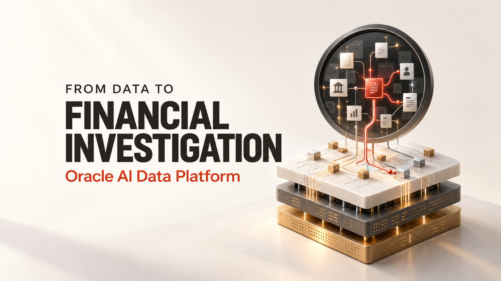
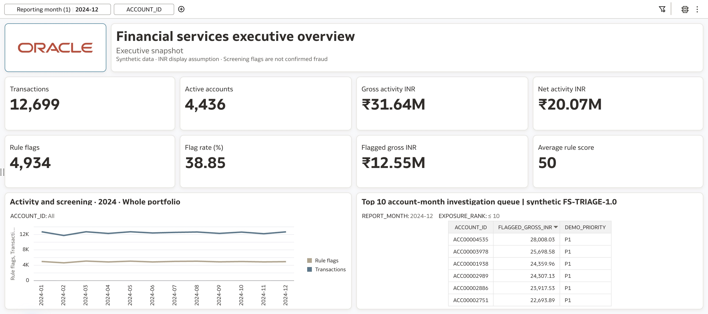

# Financial Investigation Copilot with Oracle AI Data Platform

[](LICENSE)
[](requirements/app.txt)
[](https://www.oracle.com/artificial-intelligence/ai-data-platform/)
[](docs/metrics-and-methodology.md)



**From a monthly portfolio question to an account, supporting transactions and cited policy.**

[Watch the demo on YouTube](https://www.youtube.com/watch?v=7Jhn-jmz2vg) · [Companion Medium article (draft)](https://medium.com/@abhijit.khuperkar/73440372750f) · [Download the video](video/final/aidp-financial-investigation-copilot.mp4)

This project follows a financial investigation at the fictional Meridian Demo Bank. Spark notebooks curate transactions through medallion layers, publish Gold data to Autonomous AI Lakehouse, and support Oracle Analytics Cloud dashboards. An AIDP multi-agent flow combines structured evidence, retrieved policy and an analyst brief. A Streamlit client supports deployed AIDP agents alongside Private AI Agent Factory agents through independent provider adapters.


## Start here

| Resource | Purpose |
|---|---|
| [Step-by-step user guide](docs/user-guide.md) | Set up data, publication, dashboards, agents and local client |
| [Technical article](article/medium-article.md) · [HTML preview](article/preview.html) · [Medium-ready copy](article/medium-ready.md) | Revised multi-agent story, executive dashboards, tools, testing and deployment |
| [Interactive presentation](slides/index.html) | Slide cards, keyboard navigation and presenter notes |
| [PowerPoint](slides/aidp-financial-investigation-copilot.pptx) | Editable Redwood presentation |
| [Demo video](video/README.md) | Published 7:10 motion walkthrough, MP4, captions, chapters and narration |
| [Hosted acceptance](docs/hosted-acceptance.md) | Tenant-level tests and acceptance evidence |

**Demonstration dataset; amounts shown in USD.** Screening flags and review priorities are separate from confirmed fraud, calibrated probabilities or realized loss. See the [methodology](docs/metrics-and-methodology.md) for generation, labels and metric definitions.

## Reference experience



The verified OAC reference covers 149,658 transaction rows and 5,000 accounts across January–December 2024. December includes 12,699 transactions, USD 31,642,312.97 gross activity and 4,934 rule flags. These are a frozen reference, not expected results for every rerun of an unseeded generator. The [reference manifest](data/reference-snapshot.json) records scope and definitions.

There are two structured serving paths: OAC reads native AILH Gold tables; the current seven agent SQL tools read `finance.agent_demo_fs` Spark snapshots. A model-training workflow is included separately. Its predictions are not the source of the agent's queue.

## Run the local client

Use Python 3.11. The notebook workloads run on your AIDP Spark compute.

```bash
python3.11 -m venv .venv
source .venv/bin/activate
python -m pip install -r requirements/oci.txt
cd apps/copilot
cp .streamlit/secrets.toml.example .streamlit/secrets.toml
streamlit run app.py --server.port 8501
```

In **Configuration**, select AIDP, paste your own deployed A2A endpoint and select its configured authorization mode. For OCI signing, use a locally authorized OCI profile. A copied browser session cookie is not an AIDP credential. For PAF, select the independent provider and use that installation's supported authentication and endpoint.

Keep populated secrets, wallets and `.oci` files outside Git. The public copy has no endpoint or agent default. Starting this client does not modify your existing app or deployed agent.

## Reproduce the platform workflow

1. Run the [medallion notebook](notebooks/financial_services_medallion_architecture_demo.ipynb) on AIDP, or use the [version with the optional AILH appendix](notebooks/financial_services_medallion_architecture_demo_ailh.ipynb). The first 29 cells are equivalent in both public copies.
2. Configure the existing external catalog and target schema in the AILH appendix. Inspect its dry run before enabling publication. Verify counts, amounts, types and full rows.
3. Run the [executive analytics notebook](notebooks/financial_services_executive_analytics_dashboards_aidp.ipynb); build the OAC datasets and six canvases described in the guide.
4. Run the [agent setup notebook](notebooks/financial_services_multi_agent_demo_setup_aidp.ipynb), then configure nodes from [current node configurations](agents/node-configurations.json). The builder embeds the same reviewed definitions in the setup notebook; the Prompt input is `evidence_packet` (String).
5. Ingest the eight policy documents, test SQL and RAG separately, then run the integrated acceptance cases.
6. Populate the agent card, deploy, add to AI Registry and test in Agent Hub. Connect the local client and reconcile a fresh hybrid response before presenting it as accepted.

The [user guide](docs/user-guide.md) includes exact settings, model references, query parameters, chart calculations, deployment and troubleshooting. Model availability and supported connector features depend on your tenant.

## Validation status

| Area | Reference evidence | Remaining check |
|---|---|---|
| Gold → AILH | Initial two-table publication and full-row comparison verified | Changed-data replacement after connector error |
| OAC | Six USD canvases captured 18 October 2026; reference values and saved layout preserved | Revalidate against your source snapshot |
| Agent Hub | Seven prompts reported successful by the author | Full internal tool traces and current acceptance log |
| Streamlit | Signed endpoint/card, invocation and SQL response verified historically | Hybrid evidence reconciliation previously failed; fresh hosted acceptance required |
| Local checks | See [machine-readable check report](validation/publication-checks.json) | Local mocks do not prove hosted service behavior |

The [acceptance CSV](config/tenant_acceptance_log.csv) remains `NOT_RUN` until you record your own run. No production fraud-effectiveness or time-saving measurement is claimed.

## Repository layout

```text
notebooks/          Spark medallion, AILH appendix, dashboards and setup
sql/                Seven bounded parameterized SQL queries
agents/             Current node descriptions, prompts and model settings
rag_corpus/         Eight fictional policy and investigation documents
agent_card/         Editable card metadata and form guidance
apps/copilot/       Streamlit app, provider adapters and tests
config/             SQL/RAG manifests and acceptance cases
docs/               Reproduction, architecture, methodology and troubleshooting
data/               Sanitized reference results and source provenance
media/              Diagrams, cropped screenshots and supplied brand assets
slides/             PPTX, editable sources and interactive HTML
article/            Revised Medium article, figures, sources and HTML preview
video/              Final motion video, clean master, captions, chapters and metadata
validation/         Offline contracts and optional local Spark fixture
```

## Tests

```bash
# Client transports, formatting, branding and UI with mocked services
cd apps/copilot
python -m unittest discover -s tests -v
cd ../..

# AILH appendix safety, schema and reconciliation contracts (no Spark required)
python -m unittest discover -s validation -p 'test_*.py' -v

# Public artifact structure, preserved code and offline references
python scripts/check_publication.py
```

Optional local Spark validation requires Java 17 and [validation dependencies](requirements/validation.txt). Run `python scripts/validate_notebooks.py` only after reading its local-only adapters; it substitutes Parquet and translates catalog names. This is separate from AIDP/Delta, RAG and hosted-agent acceptance.

## Article and video publication

- **YouTube:** [Financial Investigation Copilot — Multi-Agent Workflow with Oracle AI Data Platform](https://www.youtube.com/watch?v=7Jhn-jmz2vg), published by the author on 20 October 2026.
- **Medium:** [Building a Multi-Agent Financial Investigation Copilot with Oracle AI Data Platform](https://medium.com/@abhijit.khuperkar/73440372750f). The author view still labels it Draft; the [local article](article/medium-article.md) reflects the latest reviewed content and video link.
- **Video files:** [captioned motion master](video/final/aidp-financial-investigation-copilot.mp4), [clean master](video/final/aidp-financial-investigation-copilot-clean.mp4), [English SRT](video/final/aidp-financial-investigation-copilot.en.srt) and [chapters](video/final/chapters.txt). Both MP4s are stored directly in Git and are included in a normal clone. Git LFS is not required for these files.
- **Cover:** [Medium crop-safe image](media/cover-medium-safe-v2.png). The original cover remains available at [cover.png](media/cover.png).

The final cut is **7:10.5, 1920 × 1080, 30 fps**. Platform walkthroughs use advancing recorded interactions; narration and caption timing match the approved first cut. Loading and setup are trimmed, and selected browsing is accelerated. The video is not an execution-time benchmark. Source recordings and local production caches are excluded.

Publication state and stable paths are recorded in [data/publication.json](data/publication.json). The [publishing checklist](docs/publication-checklist.md) keeps editorial delivery separate from hosted acceptance.

## License and attribution

Code, original documentation and original diagrams: [MIT](LICENSE). Suggested citation is in [CITATION.cff](CITATION.cff). Oracle marks and other third-party materials remain the property of their owners; the MIT grant does not grant trademark rights. See [NOTICE](NOTICE).

This is an independent reference implementation by Abhijit Khuperkar, not a statement of Oracle product commitments or a production fraud-detection certification.

## USD denomination release

Current artifacts use USD, policy v1.1 and rule `FS-TRIAGE-1.1` without converting or rescaling source amounts. See the [migration guide](docs/usd-migration.md) for serving-schema, KB and deployed-client steps. Historical evidence is retained separately; live USD acceptance must be recorded independently.
