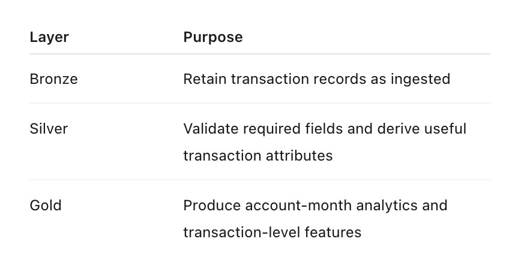
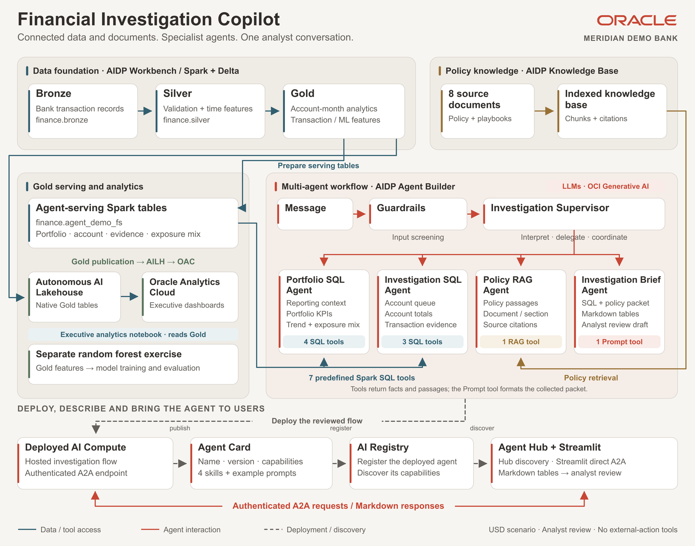
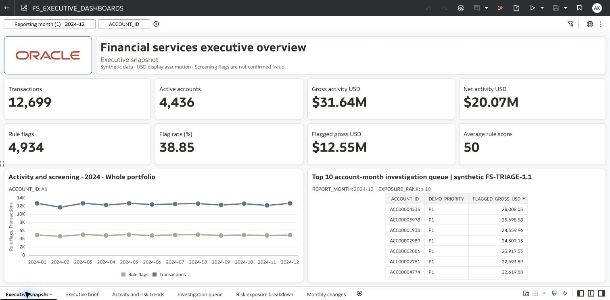
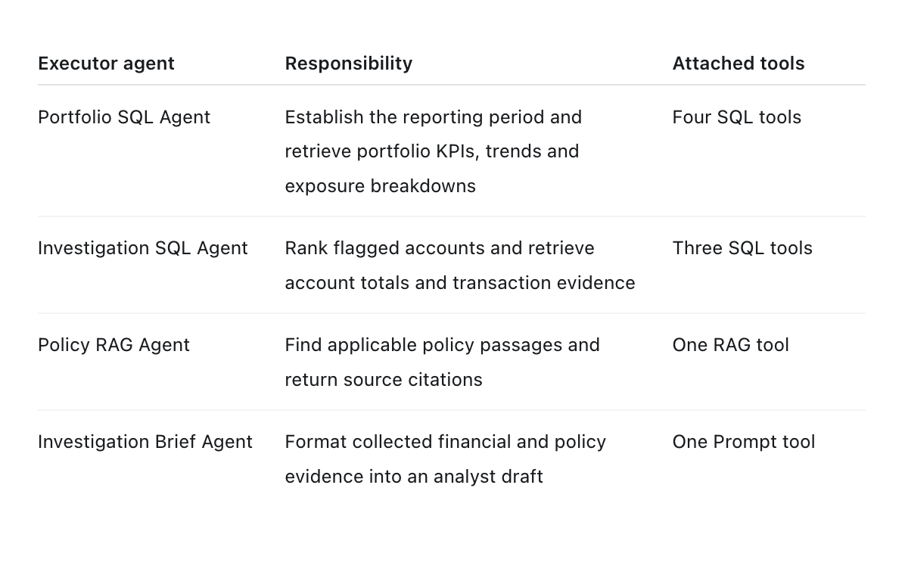
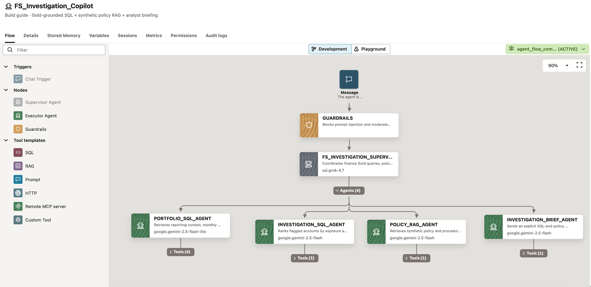
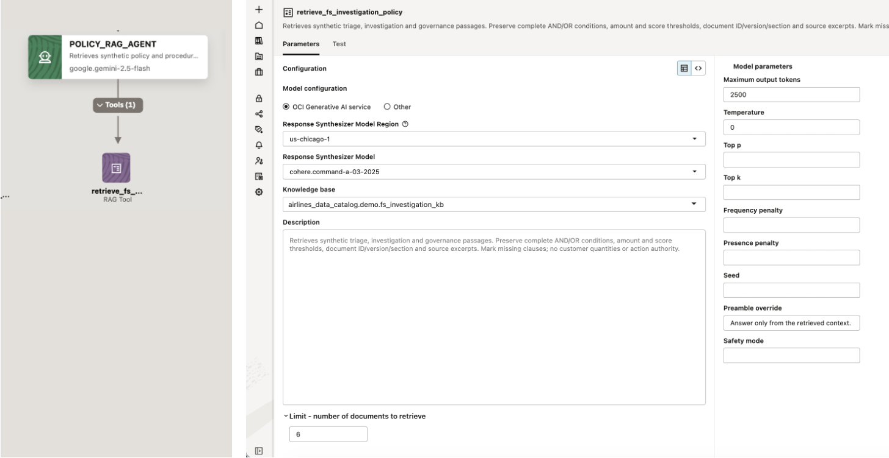
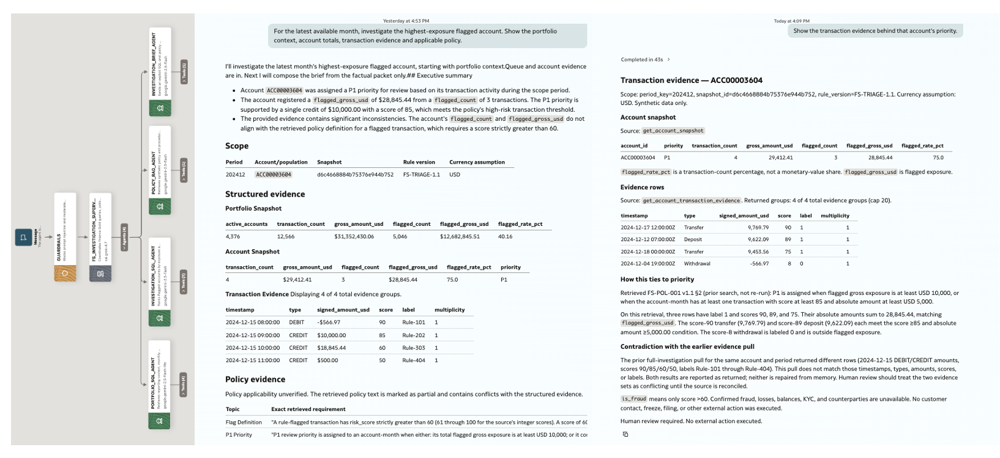
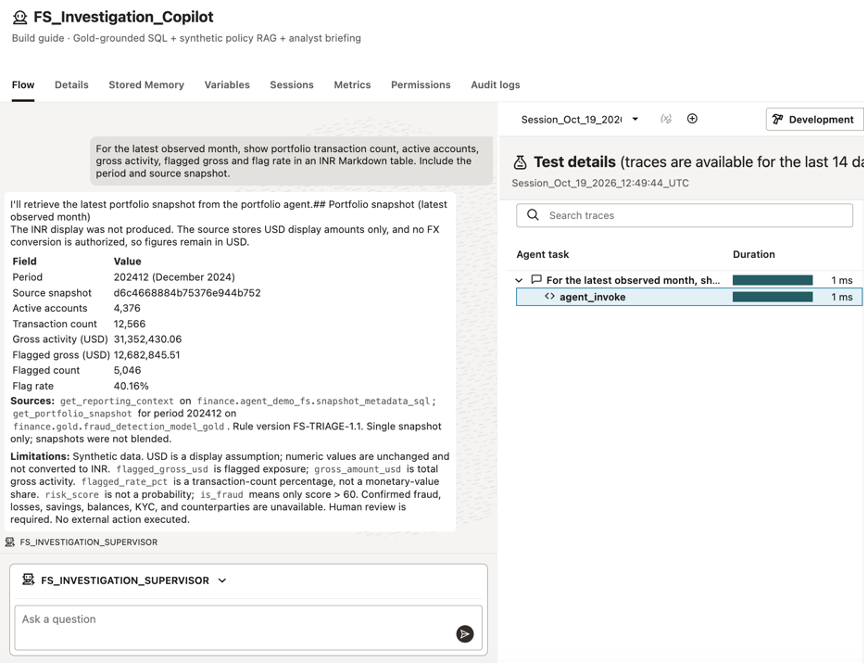
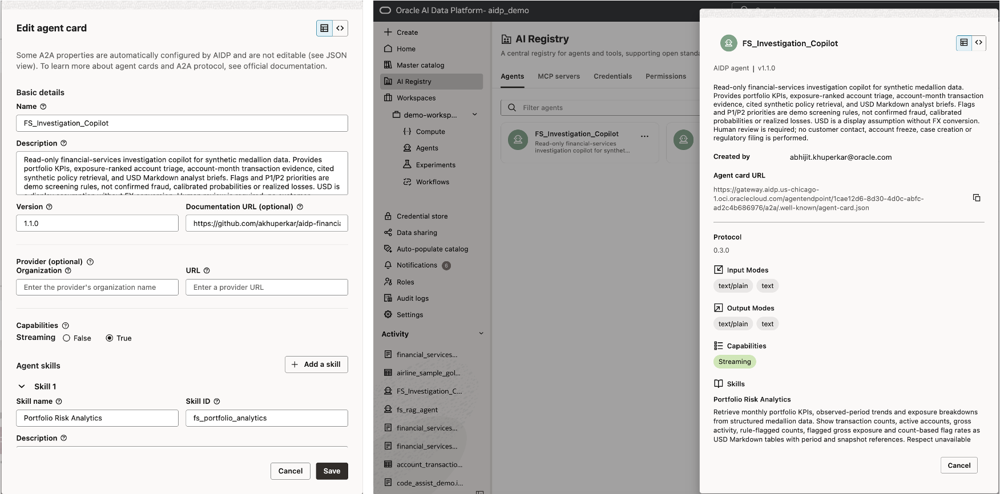
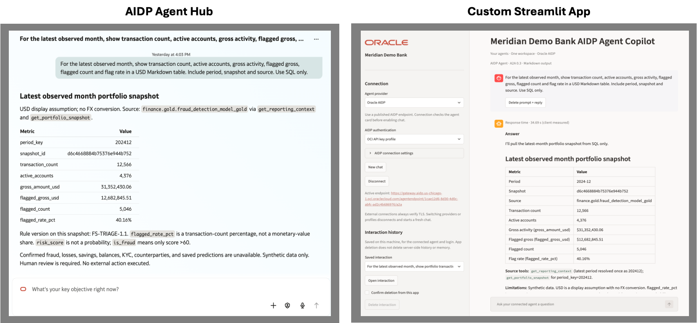

# Building a Multi-Agent Financial Investigation Copilot with Oracle AI Data Platform

Connecting financial data, policy documents and specialist agents — from a visual workflow to Agent Hub and Streamlit.

A financial analyst starts with a practical question:

> *“Which accounts should I investigate first, what activity supports that priority, and which policy applies?”*

Answering it usually involves several steps: reviewing a dashboard, querying transactions, finding the relevant policy and assembling an investigation summary.

I built a financial investigation copilot to bring those steps into one conversation. Using Oracle AI Data Platform (AIDP), a supervisor coordinates specialist agents that retrieve financial measures, examine account activity, search policy documents and prepare an analyst brief.

For Meridian Demo Bank, a fictional bank, the workflow brings connected transaction data and policy documents into one conversation to support investigation and proposed review steps.

## A data foundation that supports the conversation

Agents need access to information that has enough structure and context to answer business questions.

[Gartner](https://www.gartner.com/en/newsroom/press-releases/2025-02-26-lack-of-ai-ready-data-puts-ai-projects-at-risk) reported that 63% of organizations either lacked — or were unsure they had — the right data-management practices for AI. That finding reinforces a practical requirement: prepare the data an agent needs alongside the workflow it will support.

For this project, Spark notebooks organize banking transactions into three medallion layers:

*Financial transaction data foundation medallion layers and their purpose*

Gold data is published to Autonomous AI Lakehouse for Oracle Analytics Cloud dashboards. The copilot’s SQL tools query Gold-derived Spark serving tables stored in Delta format. Gold also supports a separate ML training and evaluation workflow.

This foundation provides the financial context. The multi-agent workflow determines how to use it.

*Financial Investigation Copilot Architecture*

## Executive dashboards provide the starting point

Before asking an agent to investigate an account, a fraud-operations leader needs a view of the portfolio.

I first created executive analytics in a Spark notebook, then built interactive dashboards in Oracle Analytics Cloud using Gold tables published to Autonomous AI Lakehouse. The workbook brings together six views: an executive snapshot, a summary brief, activity and risk trends, an investigation queue, exposure breakdowns and monthly changes.

These views answer practical questions: How much activity occurred this month? What proportion was flagged for review? Which accounts contribute the most flagged exposure? How does activity vary by transaction type and location?

The executive snapshot combines headline measures with monthly trends and a ranked account queue. Amounts are displayed in USD, with reporting-period controls providing context for the analysis.

An analyst can then take the investigation further:

> *“Investigate the highest-exposure account for this reporting month. Show the supporting transactions and the applicable review policy.”*

That question brings together structured financial data, transaction evidence and written guidance — the work coordinated by the multi-agent copilot.

*The OAC executive snapshot brings portfolio activity, screening measures and the investigation queue into one view.*

## Build a multi-agent workflow and give each agent a clear job

I built the copilot using AIDP’s no-code visual Agent Builder. The flow connects a chat trigger, guardrails, a supervisor and four executor agents.

The supervisor interprets the request and selects the specialist executors needed to answer it. Each executor has a focused role and its own attached tools.

*Specialist agents with focused roles and attached tools*

I separated these responsibilities so each specialist has focused instructions and tool access. This makes configuration, handoffs and troubleshooting easier to inspect.

A guardrails node screens incoming requests before they reach the supervisor. Agent instructions define responsibilities, permitted tools, response format and boundaries.

A policy question needs document retrieval; a portfolio question needs SQL. The supervisor selects the relevant specialists, while a broader investigation brings their results together.

Oracle documents this supervisor pattern as a way to route requests and delegate work to focused agents. [Oracle agent creation documentation](https://docs.oracle.com/en/cloud/paas/ai-data-platform/aidug/agent-creation.html).

*One supervisor coordinates portfolio analysis, account investigation, policy retrieval and brief composition.*

## Use different tools for different kinds of work

The workflow combines three tool types: SQL, retrieval-augmented generation and Prompt.

**SQL tools retrieve structured financial facts.** Seven predefined, parameterized SQL queries cover reporting context, portfolio snapshot, portfolio trends, exposure mix, priority accounts, account snapshot and transaction evidence. Runtime parameters select the reporting month, account or breakdown.

For example:

> *“Show the latest portfolio activity and rank the top five accounts by flagged gross exposure.”*

The portfolio and investigation agents select the relevant tools and supply the parameters; the queries perform the financial calculations. Responses use Markdown tables with clear labels and source references.

**The RAG tool retrieves documentary context.** A knowledge base contains eight documents covering transaction triage, investigation procedures, data definitions and review guidance.

An analyst can ask:

> *“What makes an account a P1 review priority? Quote the applicable policy conditions.”*

The Policy RAG Agent retrieves relevant passages and identifies the document, version and section. This gives the conversation access to written business guidance alongside numerical results.

*RAG tool attached to the Policy RAG Agent*

**The Prompt tool composes the brief.** Once financial facts and policy excerpts have been collected, the briefing tool formats them into a consistent response: summary, portfolio context, account evidence, policy citations and recommended analyst review.

AIDP also provides HTTP, remote Model Context Protocol (MCP), and Custom tool templates for additional integrations. [Oracle agent tools documentation](https://docs.oracle.com/en/cloud/paas/ai-data-platform/aidug/agent-flow-tools.html).

## Follow one investigation through the workflow

Consider this request:

> *“For the latest available month, investigate the account with the highest flagged exposure. Show the portfolio context, account totals, transaction evidence and applicable policy. Recommend the next analyst review steps.”*

The workflow is designed to handle it in stages:

1. **Establish the reporting context.** The Portfolio SQL Agent identifies the available period and retrieves the portfolio summary.
2. **Select the account.** The Investigation SQL Agent retrieves the exposure-ranked queue and selects its first account.
3. **Examine the activity.** The same agent obtains account totals and relevant transaction-evidence rows.
4. **Retrieve the policy.** The Policy RAG Agent finds the flagging and priority rules.
5. **Prepare the brief.** The Brief Agent passes the collected material to the Prompt tool for Markdown composition.
6. **Return proposed review steps.** The analyst receives the findings, citations and information gaps for further assessment.

The supervisor passes a scoped task to each specialist, including the reporting month and account identifier where needed. It brings the returned financial results and policy excerpts together for the Brief Agent, which uses the Prompt tool to compose the response.

The response format is part of the design. Financial measures appear in tables, policy claims carry citations, and proposed review steps are separated from observed facts.

A follow-up can then narrow the question:

> *“Show the transaction evidence behind that account’s priority.”*

This is the intended conversational value: moving from a portfolio question to account detail and policy context without requiring the analyst to assemble every intermediate request manually.

## Test the tools, then test the coordination

Testing starts with individual tools. Do the SQL results match the expected values for the selected month and account? Does the RAG tool retrieve the applicable policy and source citation? Does the Prompt tool preserve the supplied evidence while formatting the brief?

The next step is to test the agents in Playground, first independently and then through the supervisor.

Useful prompts exercise different routes:

Try “Summarize the latest portfolio activity” for SQL retrieval, “Explain the complete P1 policy rule and cite the source” for policy retrieval, and “Investigate the highest-exposure account for the latest available month” for coordination. Also test an unavailable reporting month and a request to freeze an account to check how the workflow handles missing information and its action boundary.

AIDP’s Playground supports test conversations and inspection through traces and spans. These help developers examine routing, tool calls, errors and response generation. [Oracle agent testing documentation](https://docs.oracle.com/en/cloud/paas/ai-data-platform/aidug/agent-creation.html).

Each agent also has its own model configuration. That allows model choice and output limits to reflect the task — routing, retrieval or brief composition — rather than applying identical settings everywhere.

*Agent testing in AIDP Playground*

## Describe the agent through its Agent Card

An agent needs a clear description before users or applications can discover and invoke it.

The Agent2Agent (A2A) Agent Card describes the agent’s name, purpose, version, capabilities and skills. AIDP manages protocol and deployment-related properties. I defined four skills: Portfolio Risk Analytics, Account Triage and Transaction Evidence, Synthetic Policy Retrieval, and Grounded Investigation Brief.

Each skill includes an identifier, description, tags and example prompts.

These descriptions help users understand the agent’s scope. They document capabilities; the actual behavior is implemented through agent instructions, tools and orchestration.

*The Agent Card describes the copilot’s skills; AI Registry makes the deployed agent discoverable.*

## Deploy and bring the agent to users

Deployment hosts the configured agent on AI compute and exposes authenticated endpoints. After changing the workflow, I redeploy the agent to update the hosted service. [Oracle agent deployment documentation](https://docs.oracle.com/en/cloud/paas/ai-data-platform/aidug/agent-flow-deployment.html).

I registered the deployed copilot in AI Registry and accessed it through two interfaces.

**Agent Hub** provides a conversational entry point where users can discover the registered agent and ask questions. It offers a straightforward way to introduce the copilot without building a separate user interface.

**Streamlit** demonstrates application integration. The local application connects to the deployed AIDP agent through its A2A endpoint and displays Markdown responses and tables. It also retains a separate provider connection for Private AI Agent Factory agents.

The orchestration remains on AIDP. The application supplies the user experience and invokes the deployed service.

*The deployed copilot accessed through Agent Hub and a custom Streamlit application.*

## Connect insights to the next business step

The current copilot retrieves information and proposes analyst review steps. It does not create cases, contact customers or restrict accounts.

A subsequent version could connect an HTTP or MCP tool to an investigation case-management service. That would require explicit permissions, an implemented approval step and confirmation of the external result.

An analyst can move from a portfolio question to account evidence, applicable policy and a proposed review plan through one conversation. Specialist agents coordinate the work on AIDP, while Agent Hub and Streamlit make the deployed workflow accessible to users.

The [companion repository](https://github.com/akhuperkar/aidp-financial-investigation-copilot) contains the notebooks, SQL tools, policy corpus, agent configurations and Streamlit client.

## Demo video

[Watch the Financial Investigation Copilot walkthrough on YouTube](https://www.youtube.com/watch?v=7Jhn-jmz2vg)

## Methodology note

Meridian Demo Bank uses generated transactions and fictional policies, with amounts displayed in USD. Transactions with `risk_score > 60` are flagged for review; these flags indicate screening priority, not confirmed fraud or loss, and the scores are not calibrated probabilities. A separate random forest exercise covers model training and evaluation and does not drive the copilot’s review queue. The copilot proposes analyst review steps; external operational actions are outside its current scope. Further details are available in the [methodology guide](https://github.com/akhuperkar/aidp-financial-investigation-copilot/blob/main/docs/metrics-and-methodology.md).

---

*This is a personal project, and the views expressed are my own. License and citation details are in the GitHub repository.*
