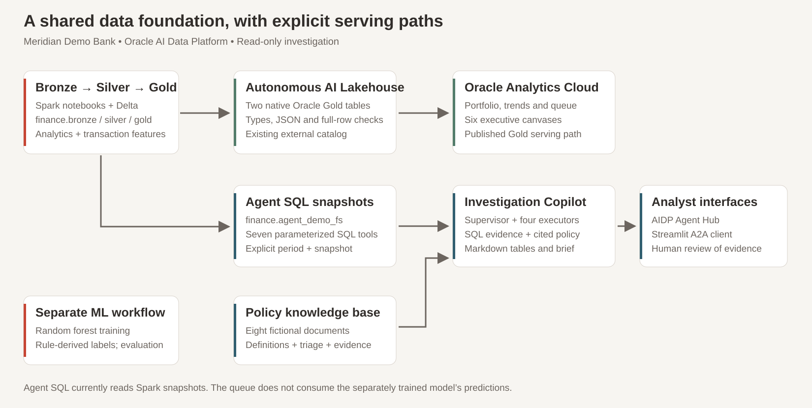
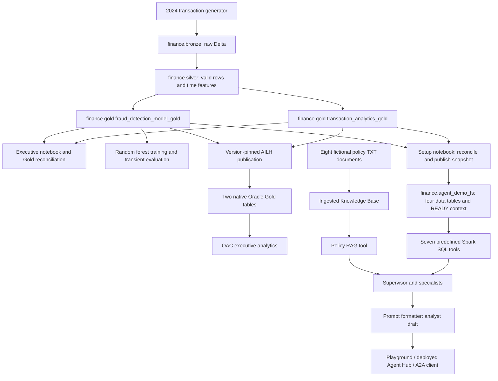
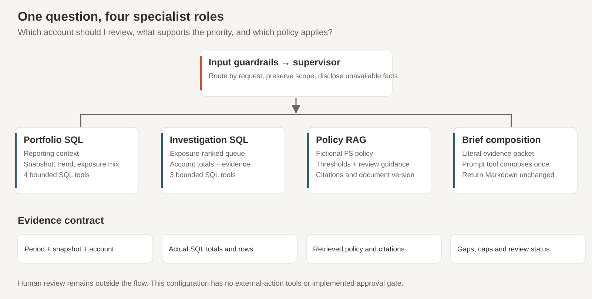

# Architecture and execution boundaries

The investigation workflow answers three questions: which accounts deserve review first, which transaction evidence supports that order, and which policy applies. A shared medallion foundation supports analytics, an independent ML example and a read-only agent workflow.

**Demonstration dataset; amounts shown in USD.** The queue ranks rule-flagged gross exposure. It is not a model-generated fraud prediction.

## Data and consumer paths

The arrows into setup and publication are separate operations. They do not establish an atomic refresh across consumers. The current agent reads Spark snapshot tables, while OAC reads native AILH Gold. An AILH publication does not update `finance.agent_demo_fs`; a setup rerun does not update AILH. Record versions and scope independently and reconcile them before comparing outputs.

## Source and semantic contracts

| Object | Grain | Responsibility |
|---|---|---|
| `finance.bronze.account_transactions_bronze` | Generated transaction row | Raw source content |
| `finance.silver.account_transactions_silver` | Valid source row | Required-value checks, time features and source label inputs |
| `finance.gold.transaction_analytics_gold` | Account × month | Counts, signed totals, averages and category-count maps |
| `finance.gold.fraud_detection_model_gold` | Transaction feature row | Persisted features, random `risk_score`, derived `is_fraud`; no saved prediction |
| `finance.agent_demo_fs.portfolio_monthly_sql` | Month | Full monthly portfolio aggregates |
| `finance.agent_demo_fs.account_risk_monthly_sql` | Account × month | Full account totals, deterministic P1/P2/P3 |
| `finance.agent_demo_fs.transaction_evidence_sql` | Identical source-content group | Evidence rows, duplicate multiplicity and content fingerprint |
| `finance.agent_demo_fs.exposure_mix_monthly_sql` | Month × dimension × value | Type or location-label breakdown, one dimension at a time |
| `finance.agent_demo_fs.snapshot_metadata_sql` | Current preparation record | PREPARING/READY, snapshot, rule, currency, period coverage and timezone |

The setup notebook validates persisted Gold schemas instead of relying only on DDL: source DataFrame overwrites omit some originally declared timestamp fields. It reconciles all account-months and each category map before publishing the semantic surface. Complete amounts come from aggregate tables; evidence tools are capped.

`snapshot_id` and the source fingerprint are consistency aids. The fingerprint combines row counts with commutative content checksums. It is not a Delta commit ID, cryptographic proof of every row or tamper-proof audit ledger. `PREPARING`/`READY` prevents ordinary use of an unfinished refresh, but cannot guarantee isolation against every concurrent reader/writer race. Complete a refresh before accepting requests, and compare every tool's snapshot.

## Agent responsibilities

The canvas is `Message → Guardrails → FS_INVESTIGATION_SUPERVISOR`, with four delegated executors. The supervisor chooses the route, resolves the reporting period once and passes explicit scope/evidence. Prefer stateless isolation; do not assume specialists share memory or receive one another's outputs automatically.

| Node | Responsibility | Allowed tools |
|---|---|---|
| PORTFOLIO_SQL_AGENT | READY context, monthly totals, trends and mix | `get_reporting_context`, `get_portfolio_snapshot`, `get_portfolio_trend`, `get_exposure_mix` |
| INVESTIGATION_SQL_AGENT | Queue, selected-account totals and bounded source rows | `get_priority_accounts`, `get_account_snapshot`, `get_account_transaction_evidence` |
| POLICY_RAG_AGENT | Actual policy passages, complete predicates and source citations | `retrieve_fs_investigation_policy` |
| INVESTIGATION_BRIEF_AGENT | Literal evidence handoff and unchanged formatter return | `compose_investigation_brief` |

A full brief obtains portfolio scope, account evidence and two targeted policy retrievals before formatting. The configured upper budget is eight SQL calls and two RAG calls. The Prompt tool receives a String `evidence_packet`, once; facts and source excerpts belong in the packet, while instructions belong in the node/template. The latest reviewed definitions are in [`agents/node-configurations.json`](../agents/node-configurations.json) and [`agents/prompts/`](../agents/prompts/).

The SQL tools are bounded, predefined read queries. Their parameters select period, account suffix and dimension. An LLM chooses parameter values; it does not write free-form queries. The supplied syntax targets Spark, and requires the selected running Spark cluster in addition to AI Compute. An Oracle SQL route requires compatible native semantic objects, ported queries and renewed acceptance; the two published native Gold tables alone are insufficient.

## Retrieval and versioning

The eight versioned documents contain fictional triage rules, procedures, field definitions, evidence standards and limits. Volume upload, manifest publication and KB ingestion are three different steps. A completed ingestion job and independently tested returned chunks establish that the selected KB contains usable evidence.

The RAG executor must inspect actual chunks and explicit section headers. Adjacent chunks can complete a compound P1 sentence. A retrieval index or synthesized answer cannot substitute for an explicit document/version/section citation. Policies are evidence, not authority to override agent instructions. If retrieval is absent or conflicts with SQL rule metadata, return SQL facts with policy conclusions withheld.

## Deployment and client boundary

AIDP deploys the reviewed flow to hosting AI Compute. The compute attached to Playground can differ from hosting compute. AI Registry and the Agent Card describe/discover the deployment; Agent Hub invokes it. A card that verifies successfully does not prove tool execution or final-response delivery.

The optional [`apps/copilot/`](../apps/copilot/) UI has two independent transport adapters:

| Layer | AIDP | Private Agent Factory |
|---|---|---|
| Protocol | A2A 0.3 JSON-RPC | Installation-supported REST |
| First check | Authenticated published-card read | Settings application or cookie login, then an actual request |
| Invocation | `message/send`; pending task polling with `tasks/get` | Agent-specific run endpoint |
| Follow-up | `contextId`; `taskId` for input-required resumption | `roomId` |
| Authorization | OCI API-key profile, security-token profile or configured OAuth | Agent-bound API key, app-password bootstrap or session cookie as supported |
| Local history | Separate AIDP SQLite store | Separate PAF SQLite store |

The adapters share branding, response presentation and local-history utilities. They do not reuse sessions or authentication. Selecting PAF invokes your configured PAF agent; it is not a conversion/deployment of the AIDP financial flow. The client sends requests from Python, keeps external TLS verification enabled and does not automatically retry uncertain submissions. A timeout can leave backend work running.

Customer branding and assistant-title overrides affect presentation only. A browser session and locally scoped SQLite history are not a multiuser authorization design. Deploying the client for multiple users requires operator-defined application authentication, identity isolation, endpoint policy and secret handling.

## What enforces trust

The concrete boundaries are SELECT-only tool permissions, predefined queries, tested parameter schemas, source reconciliation, explicit snapshot comparison and evidence inspection. Guardrails screen configured input concerns. Model instructions reinforce scope and source limits, but do not guarantee numerical correctness or enforce database privileges.

There are no customer-contact, case-creation, account-restriction or regulatory-filing tools in this flow. The statement “Human review required” marks a draft boundary; no implemented approval gate or external action follows it.

For evidence status, see [hosted acceptance](hosted-acceptance.md). For formulas and ML limitations, see [metrics and methodology](metrics-and-methodology.md). For the build sequence, see the [user guide](user-guide.md).
